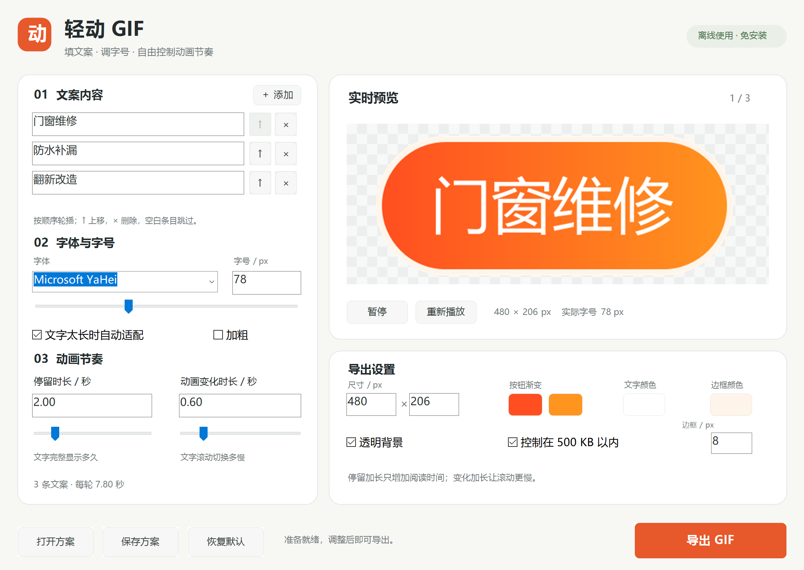

# 轻动 GIF · LightGif

**离线、免安装的 Windows 文字轮播 GIF 制作器。** 填文案、调节奏，导出透明动图。

[下载便携版](https://github.com/abel0325/lightgif/releases/latest) · [English](README.en.md) · [使用说明](docs/USAGE.zh-CN.md) · [验证范围](docs/TESTING.md)


## 可以做什么

- 1–12 条文字轮播，可调整字体、字号、渐变、边框、背景与尺寸。
- 停留时长与切换时长分别设置；长文字自动适配统一字号。
- 透明背景，保存和恢复 `.gifcfg` 方案。
- 默认启用 **小于 500,000 字节**的体积限制：逐步降低调色板或动画帧数，保持尺寸、文字与设定时长；仍无法满足时报告失败。
- 原生 C++ / Win32 / GDI+，单个 EXE；日常使用不需要 Python、Node、账号或联网。



## 开始使用

1. 在 [Releases](https://github.com/abel0325/lightgif/releases/latest) 下载 `LightGif-1.0.0-windows-x86.zip` 并解压。
2. 双击 `LightGif.exe`，填写文案，调整停留和切换时长。
3. 点击“导出 GIF”。需要复用设置时，先“保存方案”。

当前界面为简体中文。已在 Windows 10 22H2 x64 验证，程序为 x86，设计用于 Windows 10/11；Windows 11 和原生 32 位系统尚未实机验证。字体来自当前电脑，中文文案需要中文字体；没有打包任何字体。发行文件尚未进行代码签名。

## 从源码构建

需要 Windows、PowerShell 5.1 或 7、Visual Studio 2022 Build Tools 的 **Desktop development with C++** 工作负载及 Windows SDK。不要求固定安装目录；脚本使用微软 `vswhere` 查找工具链。

```powershell
./build.ps1
# 输出：build/LightGif.exe
```

如果 Windows PowerShell 的执行策略禁止本地脚本，先阅读脚本，再用 `powershell.exe -NoProfile -ExecutionPolicy RemoteSigned -File .\build.ps1` 运行。这只设置本次进程的策略，不修改系统配置；受组织策略管理的电脑请遵循组织要求。

程序使用 `/MT` 静态链接 MSVC 运行库，使用 Windows 自带系统组件；构建过程中不下载依赖。应用源文件位于 `src/`，图标源稿见 `assets/icon.svg`。

## 测试

Python 仅用于独立解码测试，不是程序运行依赖。完整中文排版测试需要 Microsoft YaHei 字体。

```powershell
python -m venv .venv
./.venv/Scripts/python.exe -m pip install -r tests/requirements.txt
./test.ps1 -Python ./.venv/Scripts/python.exe
```

测试包含 GIF 编码边界、非法输入、渲染布局、真实导出、透明度、精确时长、中文方案往返和隐藏窗口控件集成。测试报告和图片在 `build/test-results/`；不采集桌面或其他应用。GitHub Actions 运行 Windows 构建及不依赖字体的编码测试。完整实测记录见 [TESTING.md](docs/TESTING.md)。

## 更新与回退

程序无安装器、后台服务或自动更新。先关闭程序，解压新版本到单独目录；保留旧 EXE 和自己的 `.gifcfg` 方案即可回退。删除程序目录即可卸载，不会删除保存在其他位置的 GIF。

## 参与与来源

这是从实际文字动图制作需求中整理的独立项目，开发与整理使用了 AI 编程辅助。问题反馈请附版本、系统版本、字体、复现步骤，以及可以公开的最小示例；不要提交客户文案或私人文件。建议先开 Issue 讨论新功能。

项目源码使用 [MIT License](LICENSE)。应用无第三方运行时库；系统组件、测试依赖、字体与输出素材的边界见 [THIRD_PARTY.md](THIRD_PARTY.md)。
